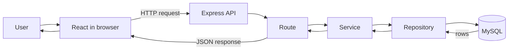

# CampusHub architecture

CampusHub uses three layers. The presentation layer is a React application created with Vite. It runs in the browser, displays campus events and booking controls, and sends HTTP requests to the API. Vite supplies the development server and fast updates while the interface is being built.

The application layer is an Express server running on Node.js. Express receives requests, validates their data, chooses the required operation, and returns JSON responses. Routes will remain small by passing business rules to services and database work to repositories. This separation makes each responsibility easier to understand and test.

The data layer is MySQL 8. It stores users and events in related InnoDB tables. The `mysql2` connection pool lets the Express process reuse database connections efficiently. Environment variables keep connection details outside committed source code.

One decision I would question is allowing a free-form event category. A separate categories table, or a carefully managed fixed list, would prevent spelling differences from fragmenting search and reporting. A separate table is more work initially, but it becomes valuable when categories need descriptions, icons, ordering, or administration.

This structure lets the client change independently while the API keeps a stable contract for future mobile and administrative applications.

